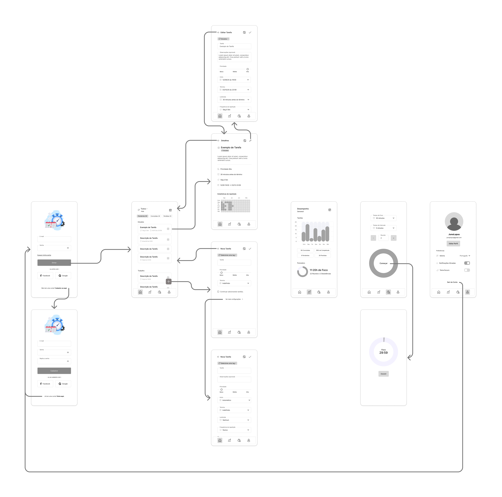

# ✅ Level Me Up

## 📌 Descrição do Projeto
**Level Me Up** é uma aplicação que combina organização pessoal com mecânicas de jogos (RPG).
O objetivo é tornar o gerenciamento de tarefas mais engajador, permitindo que o usuário ganhe
XP e suba de níveis ao concluir as suas atividades diárias.

Este projeto nasceu inicialmente como parte da disciplina de *Projeto de Interface Web* no
curso de Sistemas para Internet do IFTO (Campus Palmas) como uma simples *Task List*,
e agora está sendo evoluído com foco em arquitetura de software escalável.

---

## ⚙️ V1.0 - MVP (Em desenvolvimento)
O foco atual é o "Core Loop" da gamificação:
- 📅 **Tarefas:** Criar, Editar, Excluir, Concluir e Pular.
- 🧮 **Gamificação Básica:** Ganho de XP, Barra de Progresso e Níveis.
- 💪 **Habilidades:** Vincular tarefas a habilidades específicas (ex: "Programação").
- 🚩 **Tags:** Organização por etiquetas coloridas.
- 👤 **Perfil:** Login e Visualização de estatísticas básicas.

## 🤖 Roadmap (Futuro)
- 🔁 Repetição de Tarefas (Diárias, Semanais, Mensais, Anuais, Personalizadas)
- 📈 Relatório de desempenho e gráficos
- ⏰ Pomodoro Timer
- 🌙 Tema escuro (Dark Mode)
- 🔔 Notificações de lembrete
- 🌳 Árvore de Habilidades (Habilidades com sub-habilidades)
- 🗂️ Tipos de Tarefas:
  - Normal (*Padrão*)
  - Contagem (Vezes, Minutos, Horas, Litros, Páginas)
  - Hábito Bom
  - Hábito Ruim
- 💀 Sistema de Hábitos Ruins e Punições.
- 🪙 Moedas
- 🏪 Loja Virtual

---

## 💻 Tecnologias Utilizadas

>    
---

## 📄 Documentação

A documentação completa do projeto está publicada em:

> 📚 **[junoplupus.github.io/level-me-up](https://junoplupus.github.io/level-me-up)**

Inclui requisitos, detalhamento de casos de uso, diagramas de classes, de pacotes e diagramas de sequência.

Os arquivos-fonte da documentação estão na pasta [`docs/`](./docs).

### 🎨 Wireframe

O projeto foi desenvolvido com base em um **wireframe** previamente planejado, utilizando a ferramenta 'Figma'.

---

## 🚀 Como Executar o Projeto
> Pré-Requisitos:
> - Node.js v20+
> - Angular CLI
> - Git
> - Java 21 LTS (Necessário apenas para rodar o SonarQube)

1. Acesse o terminal;

2. Clone o repositório:
   ``git clone https://github.com/JunoPLupus/level-me-up-app.git``

3. Navegue até o diretório do projeto:
   ``cd level-me-up-app``

4. Instale as dependências:
   ``npm install``

5. Inicie o servidor de desenvolvimento:
   ``ng serve`` ou ``npm serve --open`` (se preferir abrir automaticamente no navegador).

6. Abra o navegador e acesse:
   ``http://localhost:4200``

---

📝 Licença
Este projeto está sob a licença MIT. Veja o arquivo [LICENSE](LICENSE) para mais detalhes.

---

Desenvolvido por Juno Piazza Lopes (JunoPLupus 🐺).
