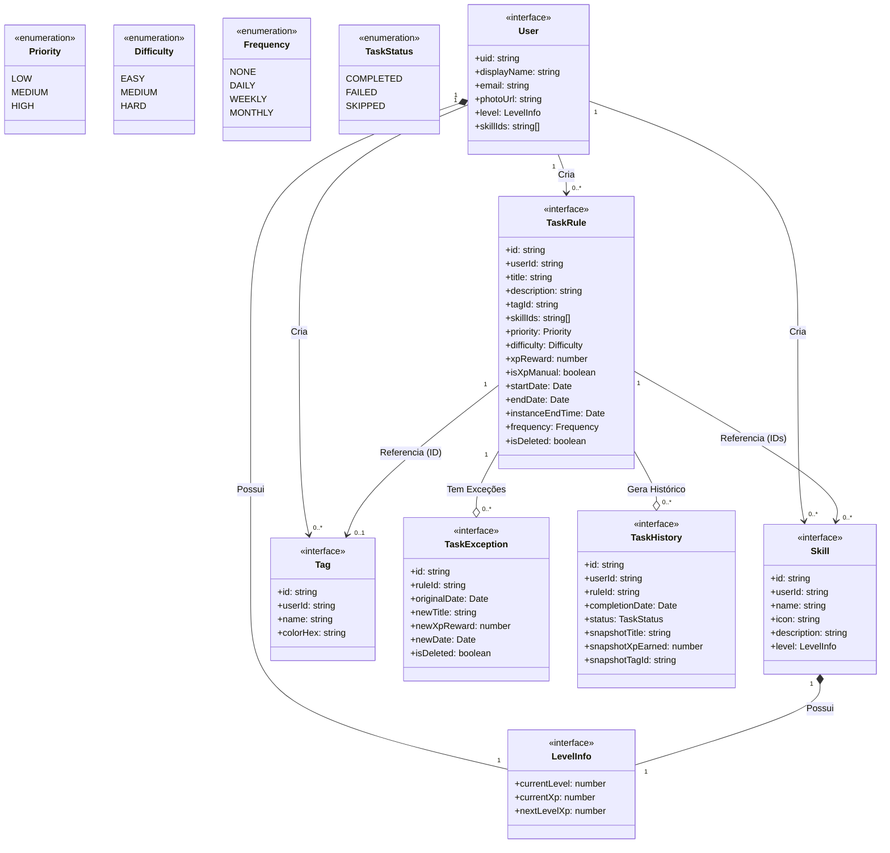

# :building_construction: Diagrama de Classes — v1.0

---

## Diagrama

---

## Descrição das Entidades

### :bust_in_silhouette: User
Representa o usuário autenticado. Possui um `LevelInfo` geral e referências às suas habilidades.

### :muscle: Skill
Habilidade criada pelo usuário (ex: "Programação", "Saúde"). Possui seu próprio `LevelInfo` que evolui com base nas tarefas vinculadas.

### :triangular_flag_on_post: Tag
Etiqueta colorida para categorizar tarefas visualmente. Armazenada por referência (`tagId`) nas tarefas.

### :clipboard: TaskRule
**Entidade central.** Representa a definição de uma tarefa — pode ser uma tarefa simples ou uma regra de repetição. Gera ocorrências virtuais em memória via `OccurrenceGenerator`.

### :repeat: TaskException
Exceção a uma regra recorrente — usada quando uma ocorrência específica é editada ou excluída sem afetar as demais.

### :scroll: TaskHistory
Registro imutável de uma tarefa concluída, desistida ou falhou. Contém snapshots dos dados no momento da ação para fins de histórico e relatórios.

### :bar_chart: LevelInfo
Value object embutido em `User` e `Skill`. Representa o estado atual de progressão (nível, XP atual, XP necessário para o próximo nível).
