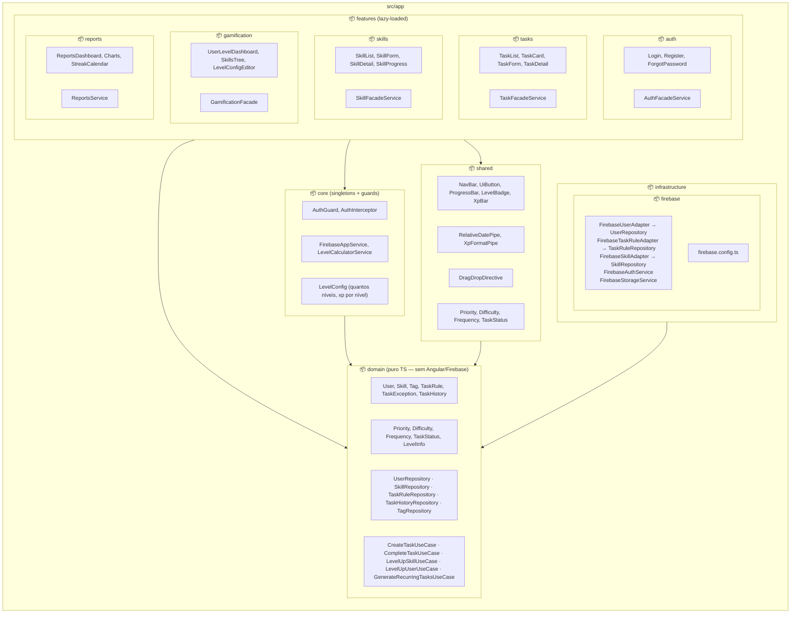
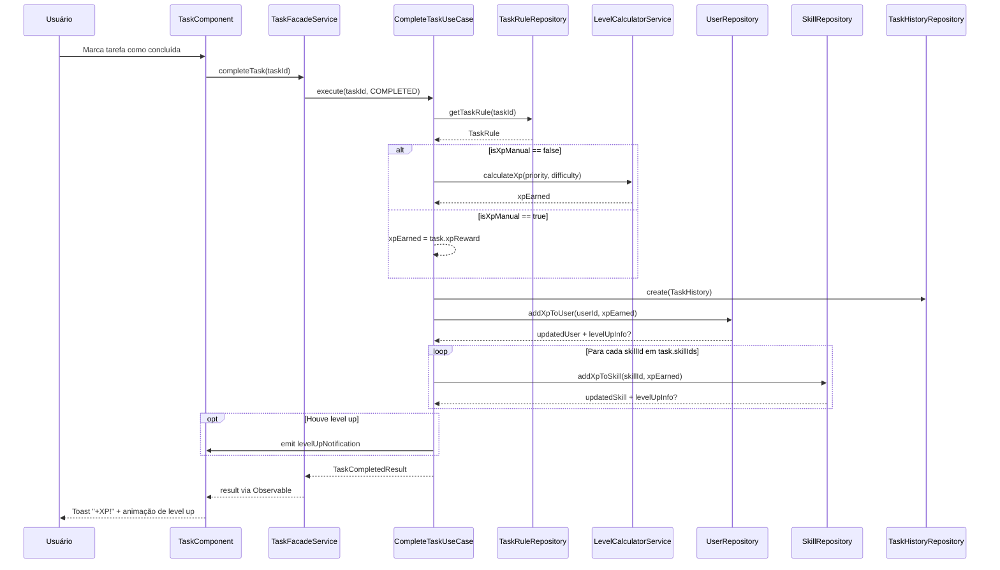

# :package: Diagrama de Pacotes — v1.0

---

## Diagrama de Pacotes

---

## Descrição dos Pacotes

### :lock: `core`
Serviços singleton e guards de autenticação. Contém a lógica de configuração de níveis (`LevelConfig`) e o `LevelCalculatorService`, que calcula XP e level-ups.

> **Regra:** se é configuração do app, estado global do Angular ou singleton de infraestrutura → `core/`

### :jigsaw: `shared`
Componentes, pipes e diretivas reutilizáveis sem dependência de feature específica. Exemplos: barra de XP, badge de nível, botões genéricos.

### :brain: `domain`
**Camada mais importante.** TypeScript puro — sem Angular, sem Firebase. Contém entidades, value objects, interfaces de repositório e casos de uso. É o coração das regras de negócio.

> **Regra:** se representa uma regra de negócio ou conceito do problema (tarefa gamificada, skill com level, XP) → `domain/`

### :electric_plug: `infrastructure`
Implementações concretas das interfaces do `domain`. Os adapters Firebase implementam os repositórios definidos no domínio, mantendo o domínio isolado de dependências externas.

### :sparkles: `features`
Módulos lazy-loaded, um por funcionalidade principal. Cada feature tem seus próprios componentes, páginas e um `FacadeService` que orquestra os casos de uso do `domain`.

---

## Diagrama de Sequência — XP Automático

Fluxo completo ao concluir uma tarefa, incluindo distribuição de XP e possível level-up:

