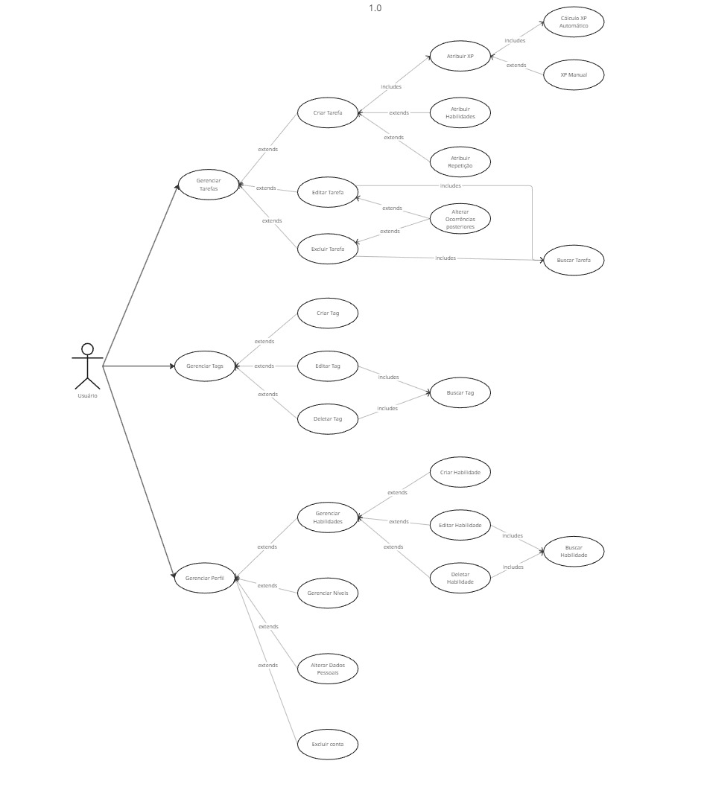

# :busts_in_silhouette: Casos de Uso — v1.0

---

## Índice

### :triangular_flag_on_post: Tarefas

| UC | Descrição | Requisitos |
|---|---|---|
| [UC01 - Listar Tarefas](uc01.md) | O usuário visualiza as tarefas de um dia | RF01 |
| [UC02 - Interagir com Tarefa](uc02.md) | O usuário visualiza, edita ou exclui uma tarefa | RF01 |
| [UC03 - Criar Tarefa](uc03.md) | O usuário cadastra uma nova tarefa | RF01, RF02, RF03, RF04 |
| [UC04 - Editar Tarefa](uc04.md) | O usuário edita os campos de uma tarefa existente | RF01, RF02, RF03, RF04 |
| [UC05 - Excluir Tarefa](uc05.md) | O usuário exclui uma tarefa existente | RF01 |
| [UC06 - Desistir da Tarefa](uc06.md) | O usuário desiste da tarefa atual | RF01 |

### :label: Tags

| UC | Descrição | Requisitos |
|---|---|---|
| [UC07 - Listar Tags](uc07.md) | O usuário visualiza e gerencia suas etiquetas | RF05 |
| [UC08 - Criar Tag](uc08.md) | O usuário cria uma nova etiqueta | RF05 |
| [UC09 - Editar Tag](uc09.md) | O usuário altera nome ou cor de uma tag | RF05 |
| [UC10 - Excluir Tag](uc10.md) | O usuário remove uma etiqueta | RF05 |

---

## Diagrama Geral

