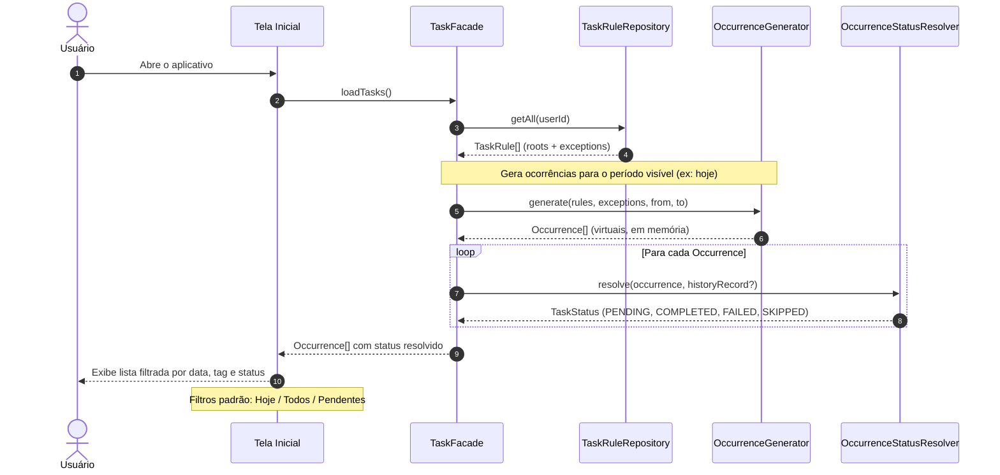

# UC01 — Listar Tarefas

| | |
|---|---|
| **Descrição** | O usuário pode visualizar as tarefas de um dia. |
| **Pré-condições** | Estar logado no sistema. |

---

## :arrow_forward: Fluxo Principal

1. O sistema direciona o usuário para a **tela inicial**;
2. A tela inicial exibe:
  - Filtro de **data** *(padrão: Hoje)*
  - Filtro de **tag** *(padrão: Todos)*
  - Filtro de **status** *(padrão: Pendentes)*
  - Lista de tarefas de acordo com os filtros aplicados
  - Botão **`+`** para criar nova tarefa
3. Este caso de uso pode acionar **[UC02](uc02.md)** ou **[UC03](uc03.md)** dependendo da interação do usuário.

---

## :twisted_rightwards_arrows: Diagrama de Sequência

