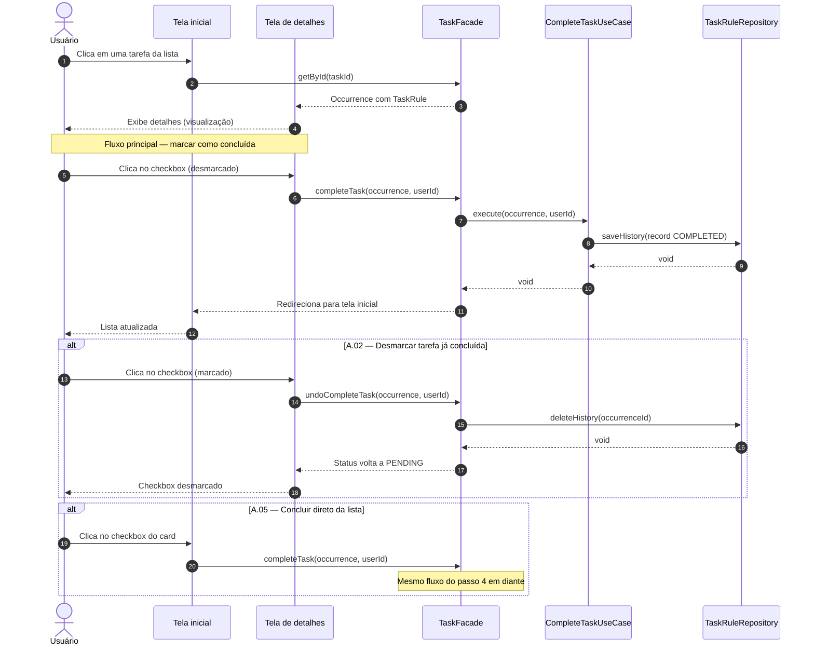

# UC02 — Interagir com a Tarefa

| | |
|---|---|
| **Descrição** | O usuário pode visualizar, editar, excluir ou concluir uma tarefa. |
| **Pré-condições** | Estar logado no sistema. |

---

## :arrow_forward: Fluxo Principal

1. Acionado pelo **[UC01](uc01.md)** quando o usuário clica em uma tarefa da listagem;
2. O sistema redireciona para a **tela de detalhes** da tarefa, com todos os atributos visíveis e as opções `editar`, `excluir` e `desistir`;
3. O usuário clica no *checkbox* (`desmarcado`);
4. O sistema persiste um registro no `TaskHistory` com `status: COMPLETED` para aquela ocorrência;
5. O sistema redireciona o usuário para a tela inicial e o caso de uso é encerrado.

---

## :arrows_counterclockwise: Fluxos Alternativos

??? note "A.01 — Editar tarefa"
1. Ocorre após o *passo 2* do fluxo principal;
2. O usuário clica na opção `editar`;
3. O caso de uso **[UC04](uc04.md)** é acionado.

??? note "A.02 — Desmarcar tarefa já concluída"
1. Ocorre após o *passo 2* do fluxo principal, quando a tarefa já consta como concluída;
2. O usuário clica no *checkbox* (`marcado`);
3. O sistema remove o registro daquela ocorrência do `TaskHistory`;
4. O caso de uso é encerrado.

??? note "A.03 — Excluir tarefa"
1. Ocorre após o *passo 2* do fluxo principal;
2. O usuário clica na opção `excluir`;
3. O caso de uso **[UC05](uc05.md)** é acionado.

??? note "A.04 — Desistir da tarefa"
1. Ocorre após o *passo 2* do fluxo principal;
2. O usuário clica na opção `desistir`;
3. O caso de uso **[UC06](uc06.md)** é acionado.

??? note "A.05 — Concluir tarefa diretamente da lista"
1. Ocorre no **[UC01](uc01.md)** sem entrar na tela de detalhes;
2. O usuário clica no *checkbox* diretamente no card da tarefa;
3. O fluxo prossegue a partir do *passo 4* do fluxo principal.

---

## :twisted_rightwards_arrows: Diagrama de Sequência

