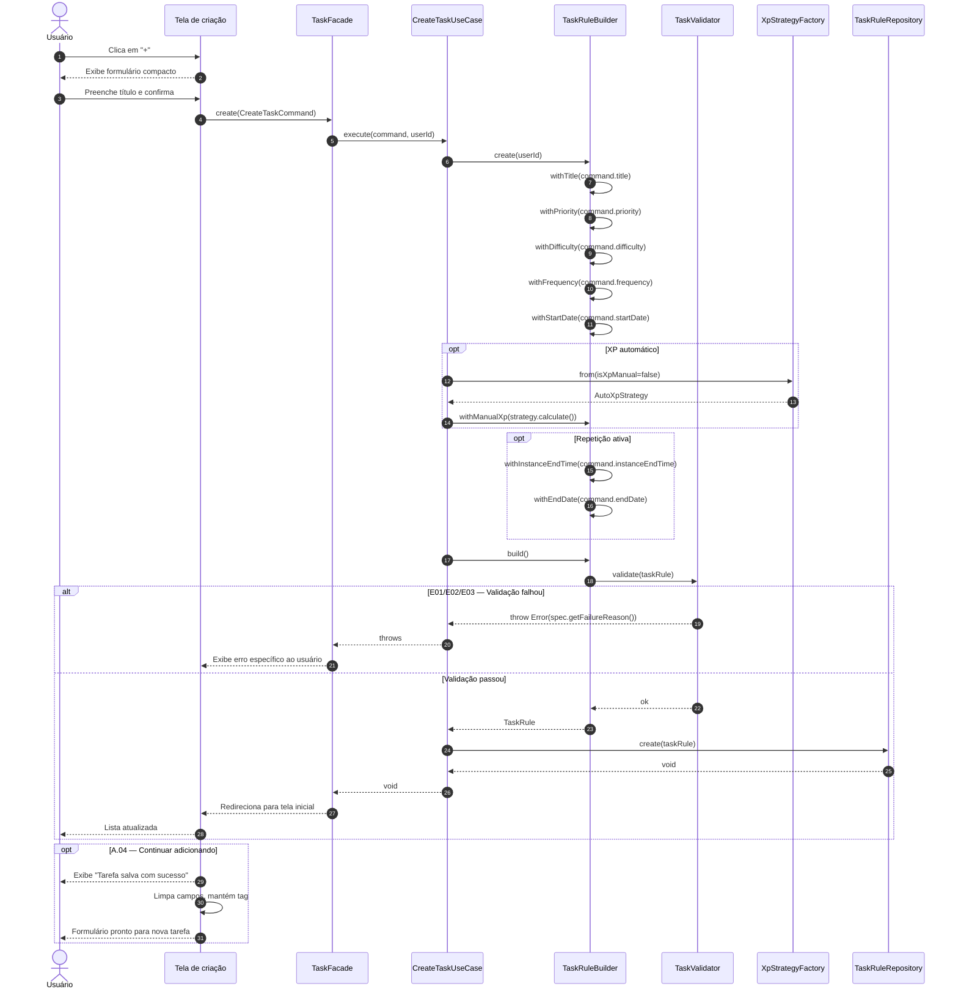

# UC03 — Criar Tarefa

| | |
|---|---|
| **Descrição** | O usuário cadastra uma nova tarefa. |
| **Pré-condições** | Estar logado no sistema. |

---

## :arrow_forward: Fluxo Principal

1. Acionado pelo **[UC01](uc01.md)** quando o usuário clica em **`+`** na tela inicial;
2. O sistema exibe a versão compacta do formulário com os campos:

| Campo | Obrigatoriedade | Padrão |
|---|---|---|
| Tag | Opcional | — |
| Título da tarefa | **Obrigatório** | — |
| Habilidades | Opcional | — |
| Prioridade | **Obrigatório** | Baixa |
| Dificuldade | **Obrigatório** | Baixa |
| XP Ganho | **Obrigatório** | Calculado automaticamente |
| Continuar adicionando tarefas | Opcional | Desmarcado |

<ol start="3" markdown="1">
<li>O usuário preenche o título;</li>
<li>O usuário clica em confirmar;</li>
<li>O sistema envia um <code>CreateTaskCommand</code> com os dados do formulário;</li>
<li>O <code>CreateTaskUseCase</code> monta a <code>TaskRule</code> via <code>TaskRuleBuilder</code> e valida via <code>TaskValidator</code>;</li>
<li>O sistema persiste a nova <code>TaskRule</code> no banco de dados;</li>
<li>O sistema verifica que a opção "Continuar adicionando tarefas" <strong>não</strong> está marcada;</li>
<li>O usuário é redirecionado para a tela inicial.</li>
</ol>

---

## :arrows_counterclockwise: Fluxos Alternativos

??? note "A.01 — Preencher todas as informações"
1. Ocorre após o *passo 2* do fluxo principal;
2. O usuário clica em **"Ver mais configurações"**;
3. O sistema exibe campos extras:

    | Campo | Padrão |
    |---|---|
    | Observações | — |
    | Início *(data/horário)* | Agora |
    | Término geral *(data/horário)* | Indefinido |
    | Frequência de Repetição | Nenhuma |

    4. O usuário preenche os campos desejados;
    5. O caso de uso prossegue a partir do *passo 4* do fluxo principal.

??? note "A.02 — Ajustar XP automático"
1. Ocorre após o *passo 3* do fluxo principal;
2. O usuário ajusta manualmente a **prioridade** e/ou a **dificuldade**;
3. O sistema recalcula o XP automaticamente via `AutoXpStrategy`;
4. O caso de uso prossegue a partir do *passo 4*.

??? note "A.03 — Inserir XP manualmente"
1. Ocorre após o *passo 3* do fluxo principal;
2. O usuário clica em **"XP Ganho"**;
3. O sistema exibe um pop-up com:
- *Cálculo automático* (checkbox, marcado por padrão)
- *XP* (campo de texto com o valor atual)
4. O usuário desmarca o cálculo automático e define o valor manualmente;
5. O usuário confirma → sistema fecha o pop-up;
6. O caso de uso prossegue a partir do *passo 4*.

??? note "A.04 — Continuar adicionando tarefas"
1. Ocorre após o *passo 7* do fluxo principal;
2. O sistema exibe notificação de sucesso **"Tarefa salva com sucesso"**;
3. O sistema limpa os campos de texto e retorna os demais ao padrão;
4. O sistema **mantém a Tag** selecionada anteriormente;
5. O caso de uso retorna ao *passo 3*.

??? note "A.05 — Definir repetição da tarefa"
1. Ocorre após o *passo 2* do fluxo principal (ou a partir do *passo 3* do *A.01*);
2. O usuário define uma frequência diferente de "Nenhuma";
3. O campo **"Prazo desta ocorrência"** se torna visível e **obrigatório** *(padrão: mesmo dia do início, às 23:59)*;
4. O sistema utiliza a data de início já definida como ponto inicial da série;
5. O caso de uso prossegue a partir do *passo 4*.

??? note "A.06 — Filtro 'Data' diferente de 'Hoje' na tela inicial"
1. Ocorre durante o *passo 2* do fluxo principal;
2. O sistema define automaticamente a **data de início** para a data selecionada no filtro;
3. O caso de uso prossegue a partir do *passo 3*.

??? note "A.07 — Filtro 'Tag' diferente de 'Todos' na tela inicial"
1. Ocorre durante o *passo 2* do fluxo principal;
2. O sistema define automaticamente a **tag** para a tag selecionada no filtro;
3. O caso de uso prossegue a partir do *passo 3*.

??? note "A.08 — Cancelar criação de tarefa"
1. Ocorre após o *passo 2* do fluxo principal;
2. O usuário clica em `<` para voltar;
3. O sistema redireciona para a tela inicial e o caso de uso é encerrado.

---

## :warning: Fluxos de Exceção

??? danger "E01 — Dados insuficientes"
1. Ocorre durante o *passo 6* do fluxo principal;
2. O sistema destaca os campos obrigatórios não preenchidos;
3. O usuário preenche os campos;
4. O caso de uso prossegue a partir do *passo 6*.

??? danger "E02 — Dados inválidos"
1. Ocorre durante o *passo 6* do fluxo principal;
2. O sistema destaca os campos inválidos e exibe a mensagem de erro específica de cada `Specification`;
3. O usuário corrige os campos;
4. O caso de uso prossegue a partir do *passo 6*.

??? danger "E03 — Conflito entre prazo da ocorrência e frequência"
1. Ocorre durante o *passo 6*, **se** a frequência for diferente de "Nenhuma";
2. O sistema verifica via `ValidFrequencySpec` se o "Prazo desta ocorrência" excede o intervalo da frequência *(ex: duração > 24h para frequência diária)*;
3. O sistema destaca os campos conflitantes e exibe: *"O prazo desta ocorrência excede o intervalo de repetição. Diminua o prazo ou selecione uma frequência mais longa."*
4. O usuário ajusta as configurações;
5. O caso de uso prossegue a partir do *passo 6*.

---

## :twisted_rightwards_arrows: Diagrama de Sequência

