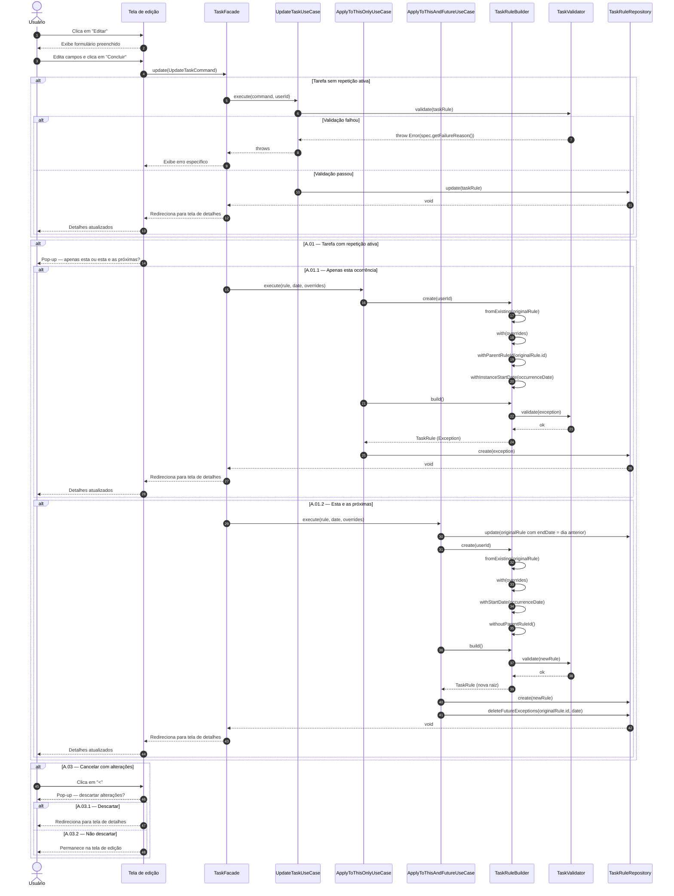

# UC04 — Editar Tarefa

| | |
|---|---|
| **Descrição** | O usuário edita os campos de uma tarefa existente. |
| **Pré-condições** | Estar logado no sistema. |

---

## :arrow_forward: Fluxo Principal

1. Acionado pelo **[UC02](uc02.md)** quando o usuário clica na opção `editar`;
2. O sistema exibe o **formulário completo** com as informações atuais da tarefa preenchidas;
3. O usuário edita um ou mais campos;
4. O usuário clica em **"Concluir"** para aplicar as alterações;
5. O sistema envia um `UpdateTaskCommand` com os dados do formulário;
6. O `UpdateTaskUseCase` valida os dados via `TaskValidator`;
7. O sistema persiste as alterações no banco de dados;
8. O sistema redireciona o usuário para a tela de detalhes e o caso de uso é encerrado.

---

## :arrows_counterclockwise: Fluxos Alternativos

??? note "A.01 — Tarefa com repetição ativa editada"
1. Ocorre após o *passo 4* do fluxo principal, caso a tarefa seja uma ocorrência de uma `TaskRule` com repetição ativa;
2. O sistema exibe pop-up: *"Aplicar alterações apenas nesta ocorrência ou nas próximas também?"*
3. O caso de uso prossegue para **A.01.1** ou **A.01.2** conforme a escolha do usuário.

??? note "A.01.1 — Aplicar alterações apenas nesta ocorrência"
1. Ocorre no *passo 3* do fluxo *A.01*, opção `Apenas nesta ocorrência`;
2. O `ApplyToThisOnlyUseCase` cria uma `TaskRule` com `parentRuleId` preenchido *(Exception)* contendo as alterações e a data da ocorrência em `instanceStartDate`;
3. A `TaskRule` original permanece intacta;
4. O caso de uso prossegue a partir do *passo 8* do fluxo principal.

??? note "A.01.2 — Aplicar alterações nesta e nas próximas ocorrências"
1. Ocorre no *passo 3* do fluxo *A.01*, opção `Nesta e nas próximas`;
2. O `ApplyToThisAndFutureUseCase` define o `endDate` da `TaskRule` original para o dia anterior à ocorrência editada;
3. O sistema cria uma nova `TaskRule` raiz *(sem `parentRuleId`)* a partir da data da ocorrência com os dados alterados;
4. Exceptions futuras já criadas são removidas, pois a nova rule passa a ser a referência;
5. O caso de uso prossegue a partir do *passo 8* do fluxo principal.

??? note "A.02 — Cancelar edição sem alterações"
1. Ocorre após o *passo 2* do fluxo principal;
2. O usuário clica em `<`;
3. O sistema verifica que **nenhum campo foi alterado**;
4. O sistema redireciona para a tela de detalhes e o caso de uso é encerrado.

??? note "A.03 — Cancelar edição com alterações realizadas"
1. Ocorre após o *passo 2* do fluxo principal;
2. O usuário clica em `<`;
3. O sistema verifica que **ao menos um campo foi alterado**;
4. O sistema exibe pop-up: *"Descartar alterações feitas?"*
5. O caso de uso prossegue para **A.03.1** ou **A.03.2** conforme a escolha do usuário.

??? note "A.03.1 — Descartar alterações"
1. Ocorre no *passo 5* do fluxo *A.03*, opção `Sim`;
2. O sistema redireciona para a tela de detalhes e o caso de uso é encerrado.

??? note "A.03.2 — Não descartar alterações"
1. Ocorre no *passo 5* do fluxo *A.03*, opção `Não`;
2. O sistema fecha o pop-up e permanece na tela de edição;
3. O caso de uso prossegue a partir do *passo 3* do fluxo principal.

---

## :warning: Fluxos de Exceção

??? danger "E01 — Dados insuficientes"
1. Ocorre durante o *passo 6* do fluxo principal;
2. O sistema destaca os campos obrigatórios não preenchidos;
3. O usuário preenche os campos;
4. O caso de uso prossegue a partir do *passo 6*.

??? danger "E02 — Dados inválidos"
1. Ocorre durante o *passo 6* do fluxo principal;
2. O sistema destaca os campos inválidos e exibe a mensagem de erro específica de cada `Specification`;
3. O usuário corrige os campos;
4. O caso de uso prossegue a partir do *passo 6*.

??? danger "E03 — Conflito entre prazo da ocorrência e frequência"
1. Ocorre durante o *passo 6*, **se** a frequência estiver ativa e houver alteração nos campos de data;
2. O sistema verifica via `ValidFrequencySpec` se o "Prazo desta ocorrência" excede o intervalo da frequência;
3. O sistema destaca os campos conflitantes e exibe: *"O prazo desta ocorrência excede o intervalo de repetição. Diminua o prazo ou selecione uma frequência mais longa."*
4. O usuário ajusta as configurações;
5. O caso de uso prossegue a partir do *passo 6*.

---

## :twisted_rightwards_arrows: Diagrama de Sequência

