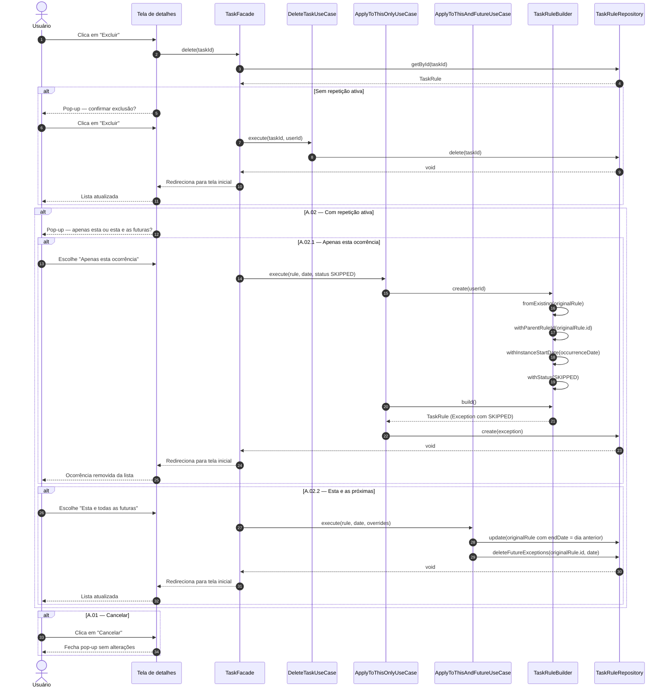

# UC05 — Excluir Tarefa

| | |
|---|---|
| **Descrição** | O usuário exclui uma tarefa existente. |
| **Pré-condições** | Estar logado no sistema. |

---

## :arrow_forward: Fluxo Principal

1. Acionado pelo **[UC02](uc02.md)** quando o usuário clica na opção `excluir`;
2. O sistema verifica se há repetição ativa naquela tarefa;
3. O sistema identifica que **não há** repetição ativa;
4. O sistema exibe pop-up de confirmação: *"Excluir esta tarefa? Esta ação é irreversível."*
5. O usuário clica em `Excluir`;
6. O sistema remove a `TaskRule` do banco de dados *(hard delete)*;
7. O sistema redireciona o usuário para a tela inicial e o caso de uso é encerrado.

---

## :arrows_counterclockwise: Fluxos Alternativos

??? note "A.01 — Cancelar exclusão"
1. Ocorre após o *passo 4* do fluxo principal ou após o *passo 2* do fluxo *A.02*;
2. O usuário clica em `Cancelar` para fechar o pop-up;
3. Nenhuma alteração é feita e o caso de uso é encerrado.

??? note "A.02 — Excluir tarefa com repetição ativa"
1. Ocorre após o *passo 2* do fluxo principal, ao identificar que há repetição ativa;
2. O sistema exibe pop-up: *"Excluir apenas esta ocorrência ou esta e todas as futuras? Esta ação é irreversível."*
3. O caso de uso prossegue para **A.02.1** ou **A.02.2** conforme a escolha do usuário.

??? note "A.02.1 — Excluir apenas esta ocorrência"
1. Ocorre no *passo 3* do fluxo *A.02*, opção `Apenas esta ocorrência`;
2. O sistema cria uma `TaskRule` com `parentRuleId` preenchido *(Exception)* contendo `status: SKIPPED` e a data da ocorrência em `instanceStartDate`;
3. A ocorrência desaparece da lista do usuário sem gerar recompensa nem punição;
4. A `TaskRule` original e as demais ocorrências permanecem intactas;
5. O sistema redireciona para a tela inicial e o caso de uso é encerrado.

??? note "A.02.2 — Excluir esta e as próximas ocorrências"
1. Ocorre no *passo 3* do fluxo *A.02*, opção `Esta e todas as futuras`;
2. O sistema define o `endDate` da `TaskRule` original para o dia anterior à ocorrência atual;
3. O sistema remove todas as Exceptions futuras já criadas para aquela `TaskRule` *(hard delete)*;
4. O sistema redireciona para a tela inicial e o caso de uso é encerrado.

---

## :twisted_rightwards_arrows: Diagrama de Sequência

