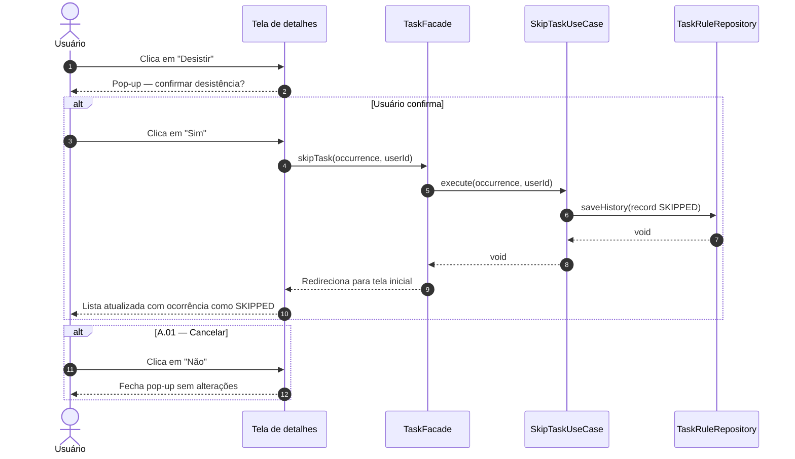

# UC06 — Desistir da Tarefa

| | |
|---|---|
| **Descrição** | O usuário desiste de uma ocorrência da tarefa, registrando-a como ignorada. |
| **Pré-condições** | Estar logado no sistema. |

---

## :arrow_forward: Fluxo Principal

1. Acionado pelo **[UC02](uc02.md)** quando o usuário clica na opção `desistir`;
2. O sistema exibe pop-up de confirmação: *"Você quer mesmo desistir desta tarefa?"*
3. O usuário clica em `Sim`;
4. O sistema persiste um registro no `TaskHistory` com `status: SKIPPED` para aquela ocorrência;
5. O sistema redireciona o usuário para a tela inicial e o caso de uso é encerrado.

---

## :arrows_counterclockwise: Fluxos Alternativos

??? note "A.01 — Cancelar desistência"
1. Ocorre após o *passo 2* do fluxo principal;
2. O usuário clica em `Não`;
3. O sistema fecha o pop-up e o caso de uso é encerrado sem nenhuma alteração.

---

## :twisted_rightwards_arrows: Diagrama de Sequência

