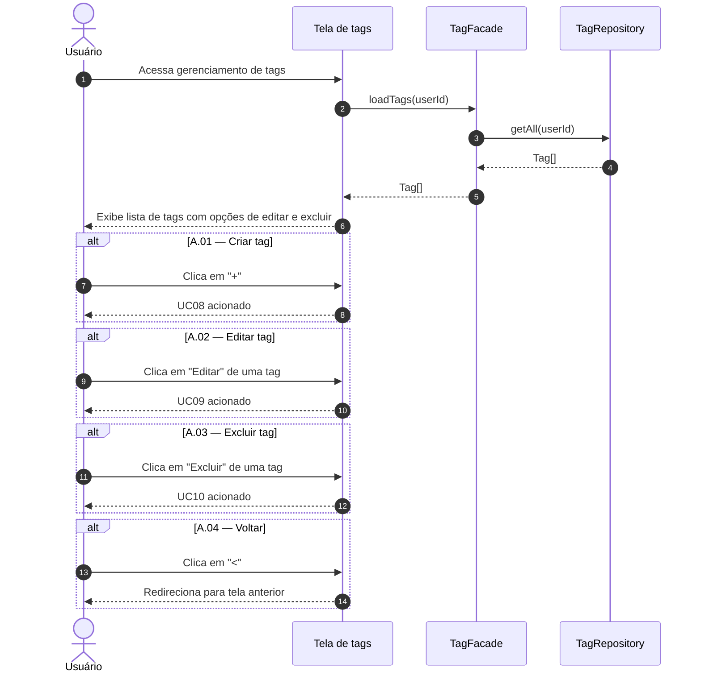

# UC07 — Listar Tags

| | |
|---|---|
| **Descrição** | O usuário visualiza e gerencia suas etiquetas personalizadas. |
| **Pré-condições** | Estar logado no sistema. |

---

## :arrow_forward: Fluxo Principal

1. Acionado pelo **[UC01](uc01.md)** via menu lateral ou ao clicar no filtro de tags;
2. O sistema busca a lista de tags do usuário no banco de dados;
3. O sistema exibe uma lista onde cada item mostra:
  - Nome da tag;
  - Cor da tag;
4. O sistema exibe a opção **`+`** para criar nova tag;
5. O sistema exibe as opções de `editar` e `excluir` ao lado de cada tag existente;
6. O caso de uso aguarda a interação do usuário.

---

## :arrows_counterclockwise: Fluxos Alternativos

??? note "A.01 — Criar tag"
1. Ocorre após o *passo 4* do fluxo principal;
2. O usuário clica em `+`;
3. O caso de uso **[UC08](uc08.md)** é acionado.

??? note "A.02 — Editar tag"
1. Ocorre após o *passo 5* do fluxo principal;
2. O usuário clica na opção `editar` de uma tag específica;
3. O caso de uso **[UC09](uc09.md)** é acionado.

??? note "A.03 — Excluir tag"
1. Ocorre após o *passo 5* do fluxo principal;
2. O usuário clica na opção `excluir` de uma tag específica;
3. O caso de uso **[UC10](uc10.md)** é acionado.

??? note "A.04 — Voltar para a tela inicial"
1. Ocorre a qualquer momento;
2. O usuário clica em `<`;
3. O sistema redireciona para a tela anterior.

---

## :twisted_rightwards_arrows: Diagrama de Sequência

