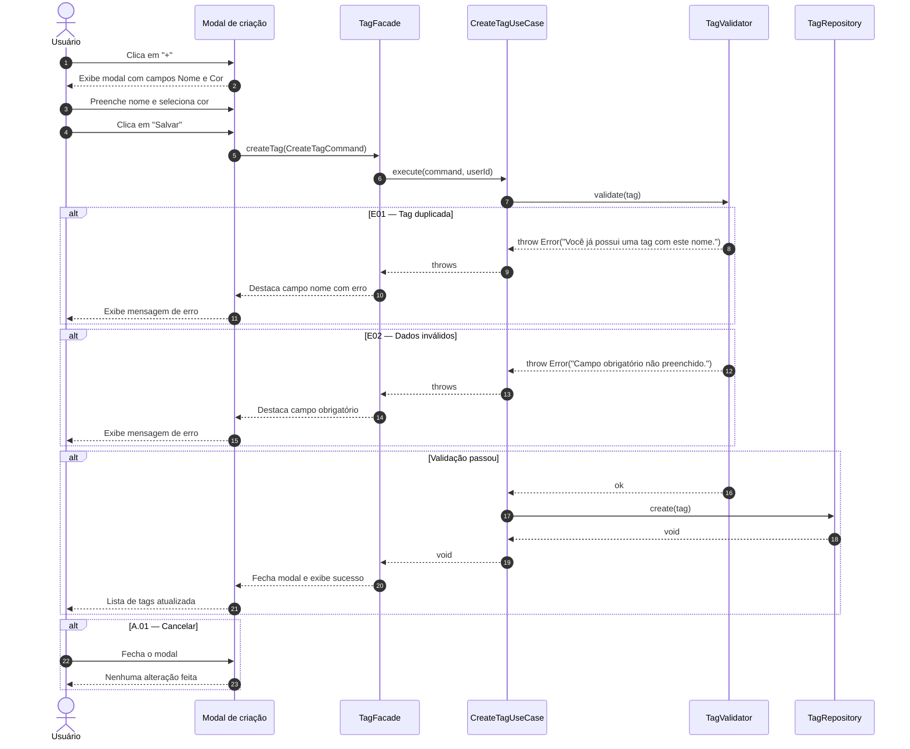

# UC08 — Criar Tag

| | |
|---|---|
| **Descrição** | O usuário cria uma nova etiqueta. |
| **Pré-condições** | Estar na tela de listagem de tags ([UC07](uc07.md)). |

---

## :arrow_forward: Fluxo Principal

1. Acionado pelo **[UC07](uc07.md)** quando o usuário clica em `+`;
2. O sistema exibe um modal com os campos:
  - Nome (`obrigatório`);
  - Cor (`obrigatório`, seleção via color picker ou paleta predefinida);
3. O usuário preenche o nome e seleciona uma cor;
4. O usuário clica em **"Salvar"**;
5. O sistema valida os dados informados;
6. O sistema persiste o registro na coleção `tags`;
7. O sistema fecha o modal, exibe mensagem de sucesso e atualiza a lista do **[UC07](uc07.md)**.

---

## :arrows_counterclockwise: Fluxos Alternativos

??? note "A.01 — Cancelar criação"
1. Ocorre após o *passo 2* do fluxo principal;
2. O usuário fecha o modal sem salvar;
3. Nenhuma alteração é feita e o caso de uso é encerrado.

---

## :warning: Fluxos de Exceção

??? danger "E01 — Tag duplicada"
1. Ocorre durante o *passo 5* do fluxo principal, se já existir uma tag com o mesmo nome para aquele usuário *(sem diferenciar maiúsculas de minúsculas)*;
2. O sistema destaca o campo nome e exibe: *"Você já possui uma tag com este nome."*
3. O usuário corrige o nome;
4. O caso de uso prossegue a partir do *passo 5*.

??? danger "E02 — Dados inválidos"
1. Ocorre durante o *passo 5* do fluxo principal, se algum campo obrigatório estiver vazio;
2. O sistema destaca o campo obrigatório não preenchido;
3. O usuário preenche o campo;
4. O caso de uso prossegue a partir do *passo 5*.

---

## :twisted_rightwards_arrows: Diagrama de Sequência

