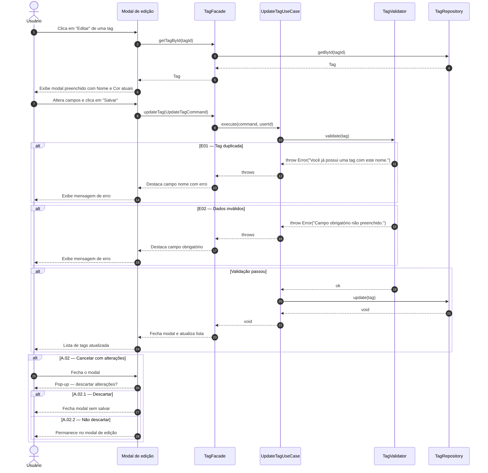

# UC09 — Editar Tag

| | |
|---|---|
| **Descrição** | O usuário altera o nome ou a cor de uma tag existente. |
| **Pré-condições** | Estar na tela de listagem de tags ([UC07](uc07.md)). |

---

## :arrow_forward: Fluxo Principal

1. Acionado pelo **[UC07](uc07.md)** quando o usuário clica na opção `editar` de uma tag;
2. O sistema exibe o modal preenchido com os dados atuais da tag *(Nome e Cor)*;
3. O usuário altera os campos desejados;
4. O usuário clica em **"Salvar"**;
5. O sistema valida os dados informados;
6. O sistema atualiza o registro no banco de dados;
7. O sistema fecha o modal e atualiza a lista do **[UC07](uc07.md)**.

!!! tip "Nota de Arquitetura"
As tarefas armazenam apenas o `tagId`. Ao editar o nome ou cor da tag, todas as tarefas vinculadas refletem a alteração automaticamente na visualização, sem nenhuma escrita adicional no banco.

---

## :arrows_counterclockwise: Fluxos Alternativos

??? note "A.01 — Cancelar edição sem alterações"
1. Ocorre após o *passo 2* do fluxo principal;
2. O usuário fecha o modal sem alterar nenhum campo;
3. Nenhuma alteração é feita e o caso de uso é encerrado.

??? note "A.02 — Cancelar edição com alterações realizadas"
1. Ocorre após o *passo 3* do fluxo principal;
2. O usuário fecha o modal após ter alterado ao menos um campo;
3. O sistema exibe pop-up: *"Descartar alterações feitas?"*
4. O caso de uso prossegue para **A.02.1** ou **A.02.2** conforme a escolha do usuário.

??? note "A.02.1 — Descartar alterações"
1. Ocorre no *passo 4* do fluxo *A.02*, opção `Sim`;
2. O sistema fecha o modal sem salvar e o caso de uso é encerrado.

??? note "A.02.2 — Não descartar alterações"
1. Ocorre no *passo 4* do fluxo *A.02*, opção `Não`;
2. O sistema fecha o pop-up e permanece no modal de edição;
3. O caso de uso prossegue a partir do *passo 3* do fluxo principal.

---

## :warning: Fluxos de Exceção

??? danger "E01 — Tag duplicada"
1. Ocorre durante o *passo 5* do fluxo principal, se o novo nome já existir para outra tag do mesmo usuário *(sem diferenciar maiúsculas de minúsculas)*;
2. O sistema destaca o campo nome e exibe: *"Você já possui uma tag com este nome."*
3. O usuário corrige o nome;
4. O caso de uso prossegue a partir do *passo 5*.

??? danger "E02 — Dados inválidos"
1. Ocorre durante o *passo 5* do fluxo principal, se algum campo obrigatório estiver vazio;
2. O sistema destaca o campo obrigatório não preenchido;
3. O usuário preenche o campo;
4. O caso de uso prossegue a partir do *passo 5*.

---

## :twisted_rightwards_arrows: Diagrama de Sequência

