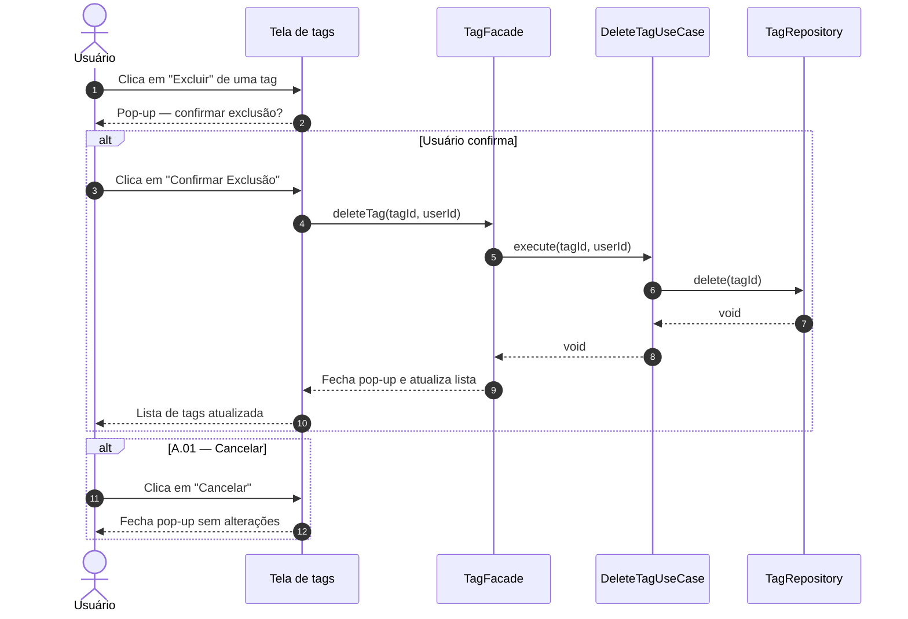

# UC10 — Excluir Tag

| | |
|---|---|
| **Descrição** | O usuário remove uma etiqueta existente. |
| **Pré-condições** | Estar na tela de listagem de tags ([UC07](uc07.md)). |

---

## :arrow_forward: Fluxo Principal

1. Acionado pelo **[UC07](uc07.md)** quando o usuário clica na opção `excluir` de uma tag;
2. O sistema exibe pop-up de confirmação: *"Tem certeza que deseja excluir a tag "[Nome]"? As tarefas associadas a ela não serão excluídas, mas ficarão sem etiqueta."*
3. O usuário clica em `Confirmar Exclusão`;
4. O sistema remove o registro da coleção `tags` *(hard delete)*;
5. O sistema fecha o pop-up e atualiza a lista do **[UC07](uc07.md)**.

!!! tip "Nota de Arquitetura"
As tarefas armazenam apenas o `tagId`. Ao excluir a tag, as tarefas vinculadas não são removidas — o campo `tagId` passa a não encontrar correspondência e a tarefa simplesmente é exibida sem etiqueta, sem nenhuma escrita adicional no banco.

---

## :arrows_counterclockwise: Fluxos Alternativos

??? note "A.01 — Cancelar exclusão"
1. Ocorre após o *passo 2* do fluxo principal;
2. O usuário clica em `Cancelar`;
3. O sistema fecha o pop-up e nenhuma alteração é feita.

---

## :twisted_rightwards_arrows: Diagrama de Sequência

